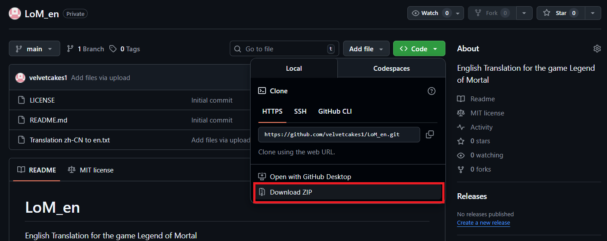
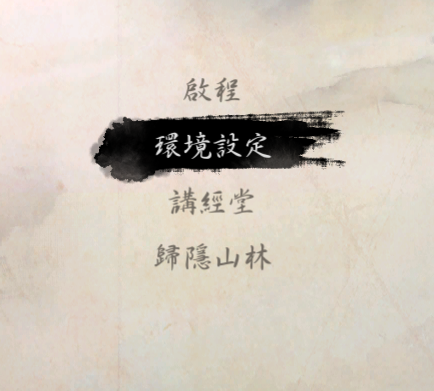
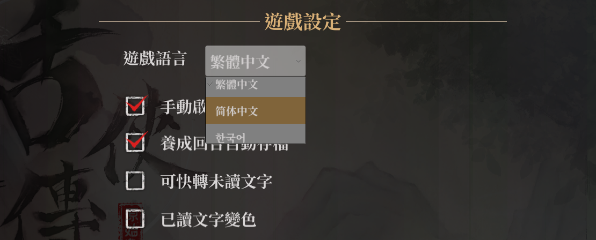

# Legend Of Mortal - EN  ( 活侠传 / 活俠傳 )

Unofficial English Translation for the game Legend of Mortal. 

Preview of an older version [Here](https://www.youtube.com/watch?v=-y4dPT-_AnA)

## Prerequisites

These are included in this repository and you do not need to download them separately. Skip to installation if you don't plan to manually get these. Links are below if you still want to get them on your own. Please note that the game executable is `32-bit` (Changed to `64-bit` after version 1.0.6000.0), and the XUnityAutoTranslator config FromLanguage needs to be `zh-CN` for Simplified Chinese. This is case sensitive. The `Translation` folder in BepinEx is required to be copied in your respective BepinEx folder.

- BepInEx [Click Here](https://github.com/BepInEx/BepInEx)

- XUnity.AutoTranslator - [Click Here](https://github.com/bbepis/XUnity.AutoTranslator)

## Installation

1. Clone or Download this repository by clicking on `<> Code` and under `HTTPS` click `Download ZIP`. Then right click and extract the zipped file you just downloaded. Keep the `Mod` folder, feel free to delete everything else.


2. Copy and Paste everything inside the `Mod` folder to your game directory. The game directory location may vary. It's usually in `C:\Program Files (x86)\Steam\steamapps\common\` but if you are unsure right click the game in your steam library and select `properties`. Under `Installed Files` click on `Browse` to open your game directory. After you're done copying the files, the game folder structure should look like this.


```
Legend_of_Mortal/
├─── BepInEx/
├─── ├─── cache/
├─── ├─── config/
├─── ├─── core/
├─── ├─── patchers/
├─── ├─── plugins/
├─── ├─── ├─── XUnity.AutoTranslator
├─── ├─── ├─── XUnity.ResourceRedirector
├─── ├─── ├─── README (AutoTranslator).md
├─── ├─── Translation/
├─── ├─── ├─── en/
├─── ├─── ├─── ├─── Text/
├─── ├─── ├─── ├─── ├─── _AutoGeneratedTranslations.txt
├─── ├─── ├─── ├─── ├─── _Postprocessors.txt
├─── ├─── ├─── ├─── ├─── _Preprocessors.txt
├─── ├─── ├─── ├─── ├─── _Substitutions.txt
├─── ├─── ├─── ├─── ├─── UI.resizer.txt               <---UI Adustments
├─── ├─── ├─── ├─── ├─── regex.txt                    <---Regex
├─── ├─── ├─── ├─── ├─── Translation_zh-CN_to_en.txt  <---Translation File
├─── ├─── ├─── ├─── Texture/...
├─── ├─── LogOutput.log
├─── Mods/
├─── MonoBleedingEdge/
├─── Mortal_Data/
├─── .doorstop_version
├─── changelog.txt
├─── doorstop_config.ini
├─── Mortal.exe
├─── UnityCrashHandler32.exe
├─── UnityPlayer.dll
└─── winhttp.dll
```

3. Start the game and select the 2nd option in the Title Screen.



4. Click the drop down menu on the top and again select the 2nd option for Simplified Chinese.



### Other notes

Please delete the existing BepInEx folder if you're updating from an older version of the repository. Leftover files that are not overwritten may cause problems with translation.

xUnityAutoTranslator might not detect text if the setting `Enable color change of read text` is on. Keep it off.

Legend remains untranslated. It is a record/summary of events that you've experienced as a player. xUnityAutoTranslator will not detect blocks of text that huge as the character limit is 2500.

If you are having trouble with the installation or would like to report mistranslated/incomprehensible text, feel free to DM me on Discord@`.velvetcakes1`

#### Story Updated for Game Version     : 1.0.5000.13
#### Last Updated                      : 28/05/2026